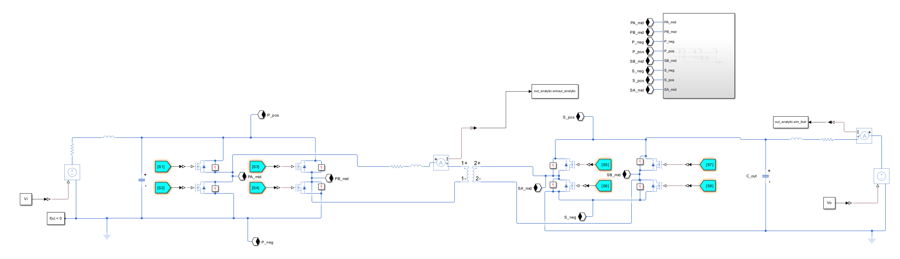
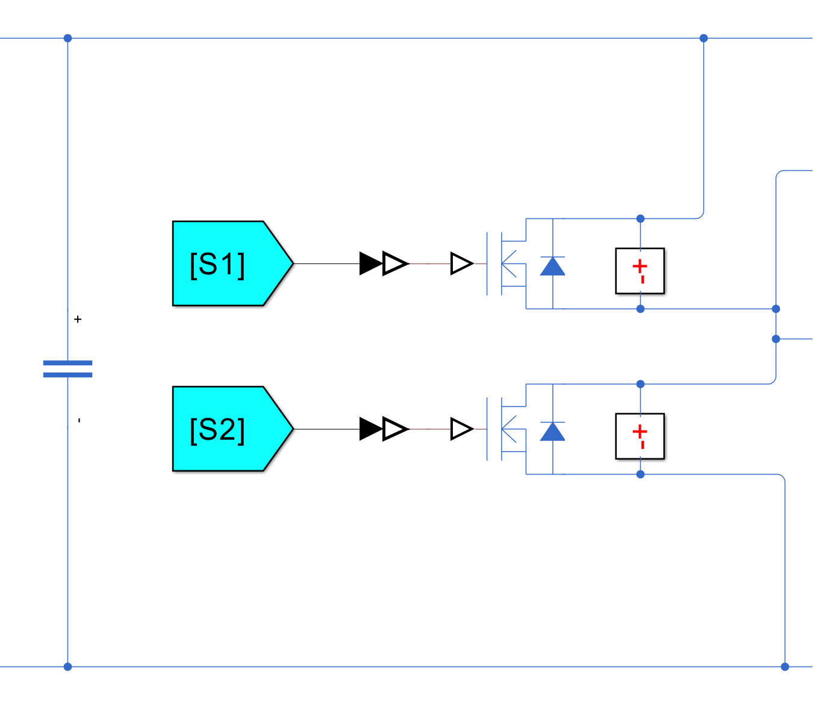
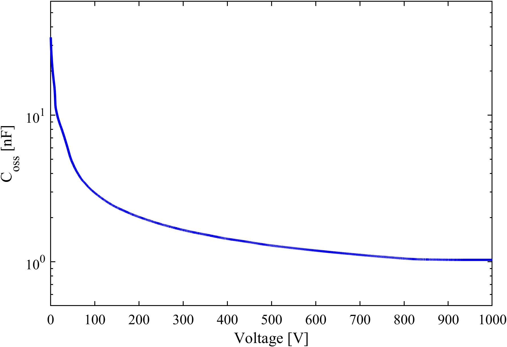
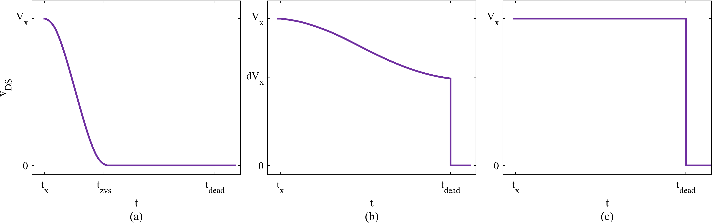
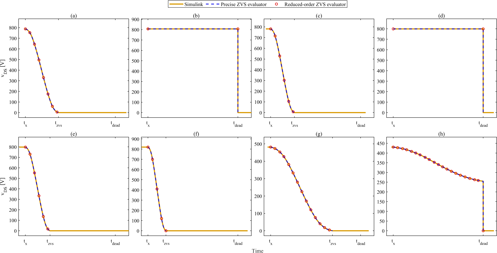
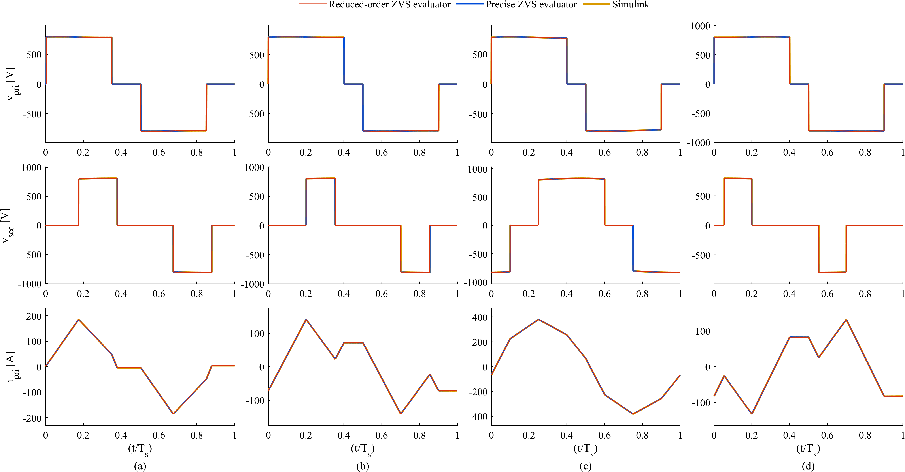
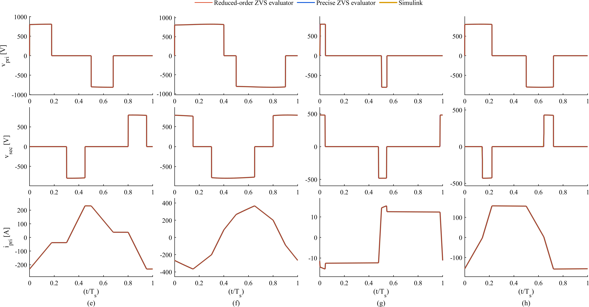
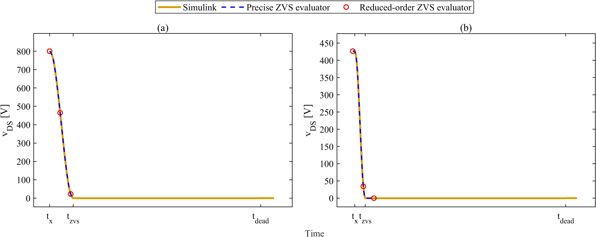

# A Precise Dead-Time ZVS Framework and a Fast Reduced-Order Evaluator for a DC–DC Converter with the Wolfspeed CAB320M17XM3 1.7 kV SiC Module

A precise ZVS framework and a reduced-order ZVS evaluator for a dual active bridge with triple-phase-shift modulation that predict, for every switching edge of a period, whether the switch turns on at zero voltage, when its transition completes and how far the transition delays the effective switching instant, using the datasheet output capacitance of the Wolfspeed CAB320M17XM3 1.7 kV SiC module. Both are validated against a circuit-level Simscape model at 21 operating points: 16 TPS mode cases in G2V and V2G operation at 800 V, and five points at 431–994 V where a primary and a secondary edge fall inside the same dead time.

## Skills Used

- Power Electronics Modelling (Dual Active Bridge, Triple-Phase-Shift)
- Soft-Switching / ZVS Analysis
- EV Charging Power Conversion (G2V / V2G)
- State-Space &amp; Analytical Converter Modelling
- SiC Device Modelling (nonlinear datasheet Coss)
- Numerical Methods (ODE solvers, quadrature, fixed-point iteration)
- Circuit Simulation &amp; Verification (Simulink / Simscape Electrical)
- MATLAB

## Project Overview

The converter is a dual active bridge between an 800 V DC link and a battery, operated in both directions: charging the battery (G2V) and feeding power back (V2G). Triple-phase-shift modulation sets the timing of the eight switching edges in each period. Between the turn-off of one switch in a leg and the turn-on of the other there is a 200 ns dead time, during which the link current moves the switch node, charging and discharging the output capacitance of both switches.

I built two evaluators that compute, for each edge, the outcome of that transition and its effect on the converter waveforms, and a Simscape model of the converter to validate them.

Design targets for the evaluators:

- All eight switching edges of a TPS period (four legs, rising and falling) evaluated at each operating point
- Datasheet Coss of the CAB320M17XM3 from 0 to 1700 V, for both switches of every leg
- 800 V DC link, 20 kHz switching, 200 ns dead time, transformer ratio n = 1.7, 37.5 µH primary-side link inductance
- Both power directions (G2V and V2G)
- Edges of the primary and the secondary bridge that fall inside the same dead time
- Validation against a circuit-level simulation with the same device capacitance

*Figure 1: Simscape Electrical model of the converter used as the test bench. From left to right: 800 V DC source with input filter and DC-link capacitor; primary full bridge (S1–S4); current sensor and primary-side link resistance and inductance; ideal transformer (n = 1.7); secondary full bridge (S5–S8); battery-side capacitor, filter and source. Each switch is an ideal MOSFET with body diode in parallel with a datasheet-table Coss block; the eight gate signals come from time-based pulse generators, and node, bus and link-current signals are logged for comparison with the evaluators.*

## What the Evaluators Compute

Both evaluators take one operating point (the three phase shifts D1, D2, D3 and the battery voltage) and return, for each of the eight edges:

- **ZVS verdict:** whether the switch node reaches its rail before the incoming switch is turned on at command + 200 ns.
- **Arrival time:** when the switch node reaches the rail, measured from the turn-off command.
- **Effective delay:** the integral of the part of the swing not yet completed, from the command to the arrival (or to the end of the dead time), fed back into the converter model as a shifted edge.
- **How the transition ends:** arrival at the rail (ZVS); still moving when the dead time ends, then forced turn-on (partial swing); no movement because the current points the wrong way (hard switching). The solvers also handle a node that stays clamped until the current reverses, and a swing that falls back when the energy runs out.
- **Coupled transitions:** edges closer together than the dead time, including a primary and a secondary edge, are solved together because they share the link current.
- **Nonlinear device capacitance:** each node sees Coss(v) + Coss(Vbus − v) of its two switches, from the datasheet curve.
- **Self-consistent operating point:** the delays and the converter waveform are iterated until the ZVS pattern repeats and the delays stop changing.
- **Converter quantities with the dead-time effects included:** link current at every edge, battery current and RMS link current.

## The Converter and Its SiC Switches

The primary bridge (legs PA and PB) sits on the 800 V DC link, the secondary bridge (legs SA and SB) on the battery side, coupled through the transformer (n = 1.7) and a 37.5 µH link inductance with 25 mΩ resistance on the primary side. Both sides have LC filters. The eight commanded edges of a period are set by three phase shifts: D1 between the two primary legs, D2 between the two secondary legs and D3 between the two bridges.

Each switch's output capacitance is taken from the CAB320M17XM3 datasheet curve (Rev. 5, Figs. 8–9). It falls from about 36 nF near 0 V to about 1 nF above 800 V.

*Figure 2: One primary leg of the Simscape model (leg PA). The high-side switch S1 and low-side switch S2 are ideal MOSFETs with body diodes, each with its own datasheet Coss block (red) connected drain to source; their midpoint is the switch node PA_mid. The gate signals [S1] and [S2] come from the pulse-generator timing.*

*Figure 3: Output capacitance of one switch of the Wolfspeed CAB320M17XM3 as used by both evaluators and the Simscape model: datasheet curve (Rev. 5, Figs. 8–9) digitized and smoothed (median over 70 logarithmic voltage bins, made non-increasing, pchip interpolation in log–log), held constant below the first digitized point (0.58 V).*

## What Happens in a Dead Time

Fig. 4 shows the voltage vDS across the switch that turns on at the end of the dead time, in three Simulink cases. At the turn-off command tx it equals the bus voltage Vx. In (a) it falls to zero at tzvs, before the dead time ends, and stays there until the gate turns on at tdead: ZVS. In (b) it is still falling at tdead and jumps from the remaining voltage dVx to zero when the switch turns on: a partial swing. In (c) it does not move during the dead time and jumps from Vx to zero at tdead: hard switching.

*Figure 4: Voltage across the switch that turns on at the end of the dead time (Simulink, datasheet Coss, 200 ns dead time). (a) Mode 5, G2V, 800 V, edge PB↑. (b) Point #540, battery 431 V, edge SA↑. (c) Mode 1, G2V, 800 V, edge SB↑. tx: turn-off command; tzvs: vDS reaches zero; tdead: the incoming switch turns on; Vx: bus voltage; dVx: voltage left at tdead.*

## Architecture: Two Evaluators

| Layer | Precise ZVS framework | Reduced-order ZVS evaluator |
|---|---|---|
| Converter model | Exact five-state model (link current, two filter-inductor currents, two bus-capacitor voltages), solved interval by interval with matrix exponentials | Analytical RL-segment model with zero-mean link current and bus-ripple correction |
| Dead-time swing | ODE integration of the switch-node voltages and the link current | Energy method along the datasheet curve, without ODE |
| Edges in one dead time | Integrated together in one ODE | Solved jointly in the link charge s = ∫ i dt |
| Device capacitance | Datasheet Coss lookup table, 5 mV steps | Same curve, with precomputed charge and energy integrals |
| Delay feedback loop | Until the ZVS pattern repeats and delays change < 0.01 ns | Until delays change < 0.1 ns; all operating points evaluated as one block |

## The Precise ZVS Framework

The converter is described by five states: the link current, the input and output filter-inductor currents, and the two bus-capacitor voltages. Between edges each interval is linear and is solved with a matrix exponential; chaining the eight intervals gives the periodic steady state directly, and a series DC term keeps the link current at zero mean.

At each commanded edge, the dead-time swing is integrated numerically from that steady state, starting with the link current and bus voltages at the command. The integrated states are the switch-node voltages and the link current, with Coss(v) + Coss(Vbus − v) at each node. The events are: clamped while the current points the wrong way, free swing, arrival or fall-back, and forced turn-on at command + 200 ns. Edges closer together than 200 ns are integrated together. The effective delays are fed back as shifted edges and the steady state is solved again, until the ZVS pattern repeats and the delays change by less than 0.01 ns.

## The Reduced-Order Evaluator

The period is modelled analytically as RL segments with a zero-mean link current and a correction for the bus-capacitor ripple, which gives the link current and bus voltages at each commanded edge.

For an edge alone in its dead time, the swing is computed with the energy method along the datasheet curve (D'Antonio et al., eq. 8): the squared current at each point of the swing is the initial value plus the energy balance against the leg capacitance, and the time to reach that point is the integral of capacitance over current. The integrals use 97 points with a cosine change of variable and the cumulative Simpson rule. The events are the same as in the precise framework. All operating points are evaluated as one block, with the same delay feedback loop.

## Two Bridges in One Dead Time

When edges fall closer together than the dead time, the reduced-order evaluator solves them together. It writes the swing in the charge delivered by the link, s = ∫ i dt, which ties the legs to one variable: each leg's charge changes in proportion to s, the squared link current changes with the link voltage integrated over s, and time is the integral of ds over the current. Arrivals, fall-backs and forced turn-ons are events along s, so the group is solved without ODE. Fig. 7 shows this case against Simscape.

## Validation Against Simscape

The Simscape model (Fig. 1) uses ideal MOSFETs with body diodes, each in parallel with a datasheet Coss block, with the same circuit parameters as the evaluators. The gates come from time-based pulse generators, so the variable-step solver hits every edge exactly. Each case is first run to steady state and then recorded with a 20 ns maximum step.

The 21 cases are the 16 TPS mode cases at 800 V (eight G2V, eight V2G) and the five two-bridge points #265, #504, #520, #522 and #540 at 431–994 V.

Fig. 5 shows eight transitions from these cases. In every panel the Simscape switch voltage, the precise framework and the reduced-order points follow the same transition and end the same way: ZVS in (a), (c), (e), (f) and (g), hard switching in (b) and (d), and a partial swing in (h).

*Figure 5: Dead-time transitions in eight Simscape cases: voltage across the switch that turns on. (a) Mode 5, G2V, PB↑. (b) Mode 1, G2V, SB↑. (c) Mode 6, G2V, PA↓. (d) Mode 1, V2G, SA↑. (e) Mode 3′, V2G, SA↑. (f) Mode 6′, V2G, PB↓. (g) Point #504 (battery 482 V), SA↓. (h) Point #540 (battery 431 V), SA↑. (a)–(f) at 800 V battery voltage. Simulink (solid), precise ZVS framework (dashed), reduced-order ZVS evaluator (circles: its computed points, one every 10 ns). The evaluator traces end where each transition is complete: at tzvs for ZVS edges, at tdead for hard and partial edges.*

Fig. 6 shows the same eight cases over one switching period. In all eight, the primary and secondary bridge voltages and the link current of the two evaluators lie on top of the Simscape waveforms.

*Figure 6: One switching period of the eight cases of Fig. 5, (a)–(h). Rows: primary bridge voltage vpri, secondary bridge voltage vsec and link current ipri, against t/Ts. Simulink, precise ZVS framework and reduced-order ZVS evaluator. In the evaluators the bridge voltages switch at the effective (delayed) edge instants they computed.*

Fig. 7 shows point #540 (battery 431 V), where the primary edge PB↑ and the secondary edge SB↓ are commanded 2 ns apart, inside the same dead time. Both switch voltages fall to zero within the dead time in Simscape and in both evaluators; both evaluators give ZVS for both edges, with effective delays of 11.2 ns (PB↑) and 4.9 ns (SB↓), the same as measured from the Simscape waveform.

*Figure 7: Two edges in one dead time at point #540 (battery 431 V): (a) primary leg, edge PB↑; (b) secondary leg, edge SB↓, commanded 2 ns later. Voltage across the switch that turns on. Simulink (solid), precise ZVS framework (dashed), reduced-order ZVS evaluator (circles: its computed points, one every 10 ns). Ticks: each leg's command tx, zero crossing tzvs and end of dead time tdead.*

## Implementation

- Precise ZVS framework and reduced-order ZVS evaluator: MATLAB (not public). The reduced-order evaluator is the dead-time evaluator of a TPS lookup-table bank.
- Simscape Electrical test bench of the converter with a datasheet Coss library: `simulink/`.
